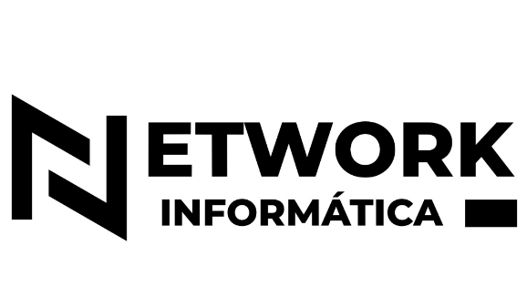

<div align="center">
  

  <h1>Infra-Monitor</h1>
  <p><strong>Instalador LXC self-host no Proxmox VE</strong> para <em>RustDesk Server</em> + API<br/>
  Identidade NETWORK Informática — fork baseado no community-scripts</p>
  <p><a href="https://github.com/junioralmeida-net/Infra-Monitor">github.com/junioralmeida-net/Infra-Monitor</a></p>
</div>

---

## O que é

**Infra-Monitor** cria um container LXC no Proxmox e instala:

- **RustDesk Server** (`hbbs` / `hbbr`) — relay e ID server
- **RustDesk API** — WebUI de administração (porta **21114**)

Os binários e serviços dentro do guest continuam com os nomes upstream (`rustdesk-*`). O que muda é a marca do instalador (nome, header, logos e URLs self-host).

---

## Requisitos

| Componente | Detalhe |
| ---------- | ------- |
| **Proxmox VE** | 8.4+ (shell root no host) |
| **Rede** | Internet no host (download dos releases) e no LXC |
| **Repo** | [junioralmeida-net/Infra-Monitor](https://github.com/junioralmeida-net/Infra-Monitor.git) publicado (branch `main`) |

---

## Instalação no Proxmox

### One-liner (Debian)

No shell do host Proxmox:

```bash
var_os='debian' bash -c "$(curl -fsSL https://raw.githubusercontent.com/junioralmeida-net/Infra-Monitor/main/ct/infra-monitor.sh)"
```

### One-liner (Alpine)

```bash
var_os='alpine' bash -c "$(curl -fsSL https://raw.githubusercontent.com/junioralmeida-net/Infra-Monitor/main/ct/infra-monitor.sh)"
```

### Clone local no host

```bash
git clone https://github.com/junioralmeida-net/Infra-Monitor.git /opt/Infra-Monitor
cd /opt/Infra-Monitor
var_os='debian' bash ct/infra-monitor.sh
```

Siga o modo **Default** ou **Advanced** e aguarde o fim da instalação.

### Acesso

```text
http://<IP-DO-LXC>:21114
```

Credenciais (Alpine): arquivo `~/rustdesk.creds` dentro do container (“Infra-Monitor WebUI (RustDesk API)”).

---

## Atualização no Proxmox

### One-liner no host (recomendado)

Atualiza o LXC Infra-Monitor existente (detecta o CT ou use `CTID=`):

```bash
bash -c "$(curl -fsSL https://raw.githubusercontent.com/junioralmeida-net/Infra-Monitor/main/tools/infra-monitor-update.sh)"
```

Com CT explícito:

```bash
CTID=106 bash -c "$(curl -fsSL https://raw.githubusercontent.com/junioralmeida-net/Infra-Monitor/main/tools/infra-monitor-update.sh)"
```

### Dentro do container

```bash
pct enter <CTID>
bash -c "$(curl -fsSL https://raw.githubusercontent.com/junioralmeida-net/Infra-Monitor/main/tools/infra-monitor-update-ct.sh)"
```

Ou, se o instalador criou `/usr/bin/update`:

```bash
pct exec <CTID> -- update
```

---

## Arquivos principais

| Caminho | Função |
| ------- | ------ |
| [`ct/infra-monitor.sh`](ct/infra-monitor.sh) | Entry point no host Proxmox |
| [`install/infra-monitor-install.sh`](install/infra-monitor-install.sh) | Install dentro do LXC |
| [`tools/infra-monitor-update.sh`](tools/infra-monitor-update.sh) | Update a partir do host Proxmox |
| [`tools/infra-monitor-update-ct.sh`](tools/infra-monitor-update-ct.sh) | Update de dentro do LXC |
| [`ct/headers/infra-monitor`](ct/headers/infra-monitor) | ASCII art no terminal |
| [`misc/images/LOGO1.png`](misc/images/LOGO1.png) | Logo principal (NETWORK, fundo claro) |
| [`misc/images/logo-network-on-dark.svg`](misc/images/logo-network-on-dark.svg) | Lockup para fundos escuros |
| [`misc/images/IdentidadeVisual.png`](misc/images/IdentidadeVisual.png) | Referência de identidade |
| [`misc/brand/preview.html`](misc/brand/preview.html) | Preview da identidade aplicada |

O instalador original `ct/rustdeskserver.sh` permanece no repositório como legado.

---

## Variável `COMMUNITY_SCRIPTS_URL`

Default: `https://raw.githubusercontent.com/junioralmeida-net/Infra-Monitor/main`

Usada para baixar `install/`, `ct/headers/`, helpers em `misc/` e o logo no MOTD. Em clone local, `COMMUNITY_SCRIPTS_ROOT` é detectado automaticamente.

---

## Identidade visual

Marca **NETWORK Informática** — [`PASTA_BASE/IdentidadeVisual.png`](PASTA_BASE/IdentidadeVisual.png) e tokens em [`misc/images/brand-tokens.css`](misc/images/brand-tokens.css) (superfícies do [`design-system-ref-agentic-builder.html`](PASTA_BASE/design-system-ref-agentic-builder.html)).

| Token | Hex | Uso |
| ----- | --- | --- |
| ink | `#1A1A1A` | Preto da marca / fundo das notas LXC |
| brand / brand-600 | `#D0572F` | Laranja oficial (barra de acento, YWB, CTAs) |
| paper | `#F5F5F5` | Off-white / texto principal |
| brand-500 | `#D97757` | Destaques e avisos (YW) |
| success | `#29E0A9` | OK / sucesso (GN) |
| info | `#4B73FF` | Info / links (BL) |
| danger | `#C63131` | Erros (RD) |

Tipografia: **Outfit** (marca / títulos) e **Inter** (corpo). Linguagem visual: escuro, geométrico, acento terracota — sem laranja saturado fora da paleta.

---

## Atribuição

- Instalador LXC baseado em [Proxmox VE Helper-Scripts / community-scripts](https://github.com/community-scripts/ProxmoxVE) (MIT)
- Pacotes: [RustDesk Server](https://github.com/rustdesk/rustdesk-server) / [lejianwen/rustdesk-server](https://github.com/lejianwen/rustdesk-server) e [lejianwen/rustdesk-api](https://github.com/lejianwen/rustdesk-api)
- Identidade visual: NETWORK Informática

---

## Licença

MIT — ver [LICENSE](LICENSE).
